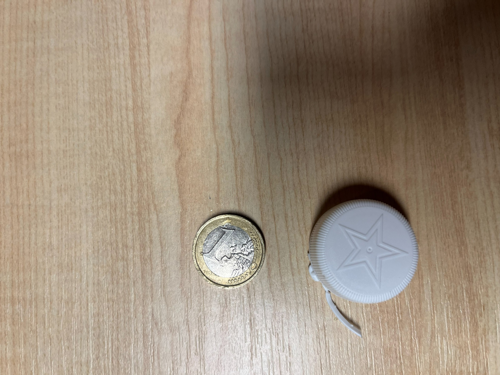
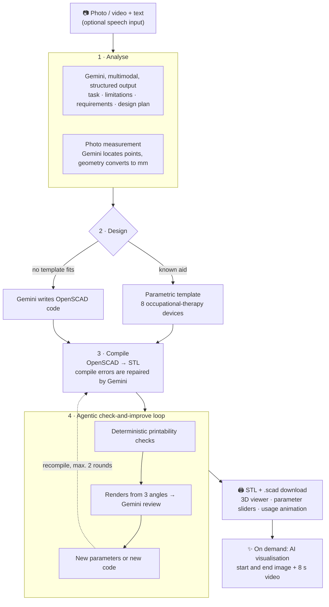

<div align="center">

# AidForge

### From an everyday problem to a print-ready assistive device

**Take a photo. Describe what is hard. Get a custom-fit, 3D-printable aid in about a minute.**


</div>

---

> **🏆 Hackathon finalist.** AidForge was built at the **TechEurope × Google DeepMind Hackathon**
> and was selected as **one of the 5 finalist projects**.
> The challenge was *open innovation*: build something new and useful on top of the latest
> Google Gemini models. Everything in this repository was created during the event.

## Table of contents

- [The idea](#the-idea)
- [How it works](#how-it-works)
- [Why it is more than an LLM wrapper](#why-it-is-more-than-an-llm-wrapper)
- [Results on real photos](#results-on-real-photos)
- [Gemini models used](#gemini-models-used)
- [Getting started](#getting-started)
- [Project structure](#project-structure)
- [Demo scenarios](#demo-scenarios)
- [Known limits](#known-limits)

## The idea

Assistive aids exist, but off-the-shelf parts rarely fit the specific object or the specific hand.
A custom one usually needs an occupational therapist *and* a CAD engineer.

AidForge closes that gap. A person with arthritis, tremor or only one usable hand:

1. takes a **photo or video** of the object, with a coin or bank card next to it for scale,
2. describes their **limitation** and the **activity** that should work again (typed or spoken),
3. receives a **print-ready 3D model** (STL + OpenSCAD source) sized to *their* object,
   plus an **AI visualisation** of the device in use.

<div align="center">

<br>
<sub>A real input photo: the 1-euro coin gives the scale, the cap is measured at Ø 35.0 ± 0.3 mm.</sub>
</div>

## How it works



Every version stays visible in the UI (`v1 → critique → v2`), so the improvement loop is transparent
rather than a black box. Results are stored in `outputs/<job>/job.json`, survive a restart and can be
opened directly via `http://localhost:8000/?job=<id>`.

## Why it is more than an LLM wrapper

| | |
|---|---|
| **Measured, not guessed** | The model only *locates* points in the photo. Scale and millimetres are computed geometrically from a reference object (coin, bank card, A4 sheet) in [`app/measure.py`](app/measure.py). |
| **Verified, not assumed** | Every version is compiled with OpenSCAD and run through deterministic checks in [`app/checks.py`](app/checks.py): watertight mesh, single part, print-bed fit, wall thickness by raycasting, overhangs, bed contact, and fit of the device against the measured object. |
| **Reviewed with evidence** | Only after the checks does Gemini review renders from three angles against the requirements *and* the check results, then proposes concrete changes. |
| **Editable without AI** | Parameter sliders rebuild the model locally; a free-text field asks Gemini for targeted changes. |

## Results on real photos

Measured on real phone photos with a 1-euro coin as reference.

| Case | Path | Photo measurement | Checks passed | Time |
|---|---|---|:---:|:---:|
| Bottle cap, weak grip | template `lever_turner` | cap Ø 35.0 ± 0.3 mm | 8 / 8 | ~1 min |
| House key, rheumatoid arthritis | template `key_turner` | key head 27.9 × 26.0 ± 0.4 mm | 10 / 10 | ~1 min |
| Mains plug, weak grip | **no template, Gemini writes the OpenSCAD** | shape from photo (low-contrast object, measurement uncertain) | 7 / 7 | ~2.5 min |

## Gemini models used

Latencies were measured with the hackathon API key.

| Step | Model | Latency |
|---|---|---|
| Analysis, review, refinement | `gemini-4-hydrogen` | 15–40 s |
| CAD code generation | `gemini-4-hydrogen` (thinking: medium) | ~30 s |
| Start and end image | `gemini-nano-banana-2.1` | ~20 s per image |
| Usage video | `gemini-omni-flash-preview` | ~50 s |
| Speech input | `gemini-3.5-transcribe` | a few seconds |

## Getting started

Instructions are for Windows; the app itself only needs Python and OpenSCAD.

**1. Install OpenSCAD**

```bash
winget install --id OpenSCAD.OpenSCAD -e
```

**2. Create the Python environment**

```bash
python -m venv .venv
```

```bash
.venv\Scripts\python -m pip install -r requirements.txt
```

**3. Configure the API key**

Copy [`.env.example`](.env.example) to `.env` and set `GEMINI_API_KEY`.
Never commit `.env`.

**4. Run**

```bash
.venv\Scripts\python -m uvicorn app.main:app --port 8000
```

Then open <http://localhost:8000>.

## Project structure

```
app/
├── main.py                FastAPI endpoints: jobs, rebuild, refine, visualise, transcribe, templates
├── pipeline.py            Analyse → design → compile → check/review loop, iterations, persistence
├── measure.py             Photo measurement: Gemini locates points, geometry converts to mm
├── checks.py              Deterministic printability checks (numpy)
├── cad.py                 OpenSCAD: sanitise, insert parameters, compile, render, dimensions
├── visualize.py           Start/end images and usage video
├── gemini.py              Gemini API wrapper, transcription
├── prompts.py, schemas.py Prompts and structured-output schemas
├── templates_registry.py  Template catalogue
└── scad_templates/        8 parametric assistive devices
web/                       UI in vanilla JS + three.js, incl. the usage animation
demo_inputs/cases/         Demo cases (case.json + media)
scripts/, tests/           CLI helpers, smoke tests, measurement tests
```

## Demo scenarios

| Limitation | Activity | Expected device |
|---|---|---|
| Rheumatoid arthritis, weak pinch grip | Unlocking the front door | Key turner, sized via coin |
| Tremor | Eating with a spoon | Weighted built-up handle |
| Tetraplegia C6, no fist closure | Brushing teeth | Universal cuff |
| One usable hand (stroke) | Opening a jam jar | Lever turner |
| One usable hand | Pushing food onto cutlery | Plate guard |
| One usable hand | Buttoning a shirt | Button hook |
| Hemiplegia | Applying toothpaste | Custom CAD design (toothbrush holder) |

`weak_grip_bottle` and `weak_grip_plug` in `demo_inputs/cases/` are real phone photos;
the remaining cases use AI-generated placeholder media.

## Known limits

- Only dimensions lying flat in the plane of the reference object can be measured.
- Dark objects with hard shadows measure poorly.
- The in-browser usage animation exists for template devices only.
- This is a hackathon prototype, not a certified medical product. Printed aids should be
  checked by the user or a therapist before relying on them.

---

<div align="center">
<sub>Built at the <b>TechEurope × Google DeepMind Hackathon</b> · one of 5 finalist projects · powered by Google Gemini</sub>
</div>
